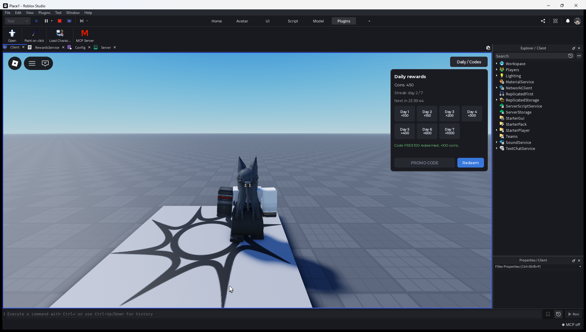

# Daily rewards

Server side daily rewards and promo codes with a small test window. The player profile (Coins, LastClaimTime, Streak, UsedCodes) lives in DataStore, the reward is available once per 24 hours, and the streak drops back to day 1 after 48 hours offline. When the place is not published and DataStore is unavailable, DataManager keeps profiles in memory so the system still runs in Studio.

## Install

Prebuilt files are attached to the [latest release](https://github.com/N0ctisL0ve/daily-rewards/releases/latest): five `.rbxm` models plus the source archives. Drop the models into Explorer:

```
Config.rbxm, Remotes.rbxm             -> ReplicatedStorage
DataManager.rbxm, RewardsService.rbxm -> ServerScriptService
RewardsUI.rbxm                        -> StarterPlayer/StarterPlayerScripts
```

With Rojo, run `rojo serve` in the repo root and connect the Rojo plugin in Studio. The Remotes folder is created by RewardsService on start, so it does not need to be built by hand.

## Studio layout

```
ReplicatedStorage
  Config            ModuleScript
  Remotes
    ClaimDaily      RemoteFunction
    RedeemCode      RemoteFunction
    DataUpdated     RemoteEvent
ServerScriptService
  DataManager       ModuleScript
  RewardsService    Script
StarterPlayer
  StarterPlayerScripts
    RewardsUI       LocalScript
```

Test codes in Config: FREE100 (+100) and WEEK7 (+700). OLDCODE is disabled on purpose to check the rejection path.


